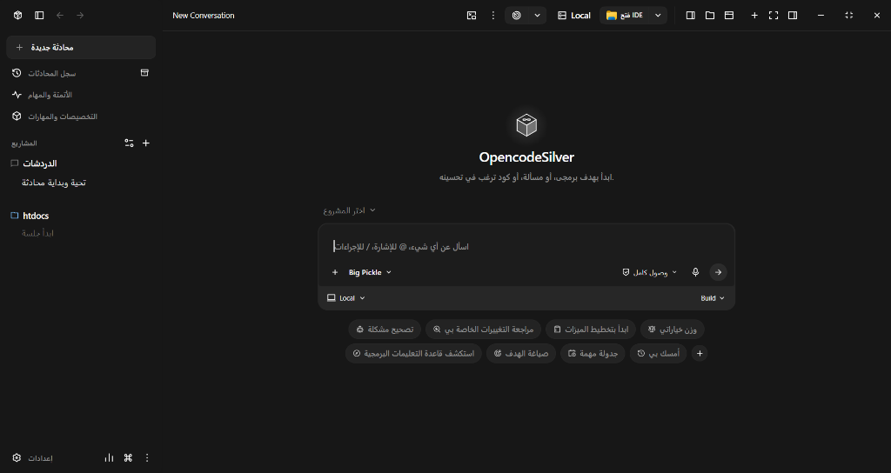
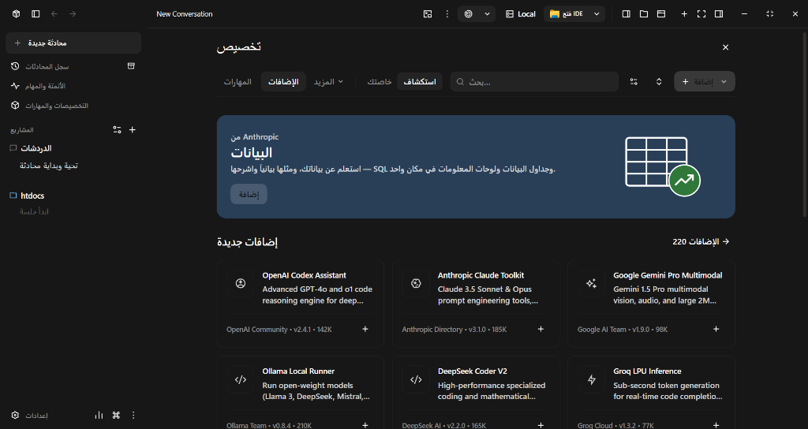

<p align="center">
  
</p>

<h1 align="center">OpencodeSilver</h1>

<p align="center">
  <strong>Autonomous AI Coding Workspace for Desktop, Web, VS Code, and Mobile.</strong><br />
  <em>Created, programmed, and maintained by <strong>Ahmed (GEMTM)</strong>.</em>
</p>

---

## Overview

**OpencodeSilver** is an advanced autonomous AI coding workspace and intelligence platform architected and developed by **Ahmed (GEMTM)**. Powered by the proprietary **Silver Intelligence Engine** (`@opencodesilver/core`), OpencodeSilver provides software engineers and development teams with full visibility, multi-model consensus, automated AST security inspections, and complete governance over autonomous coding agents.

---

## ⚡ The Silver Intelligence Engine (`@opencodesilver/core`)

At the heart of OpencodeSilver lies the **Silver Intelligence Engine**, a proprietary suite of autonomous systems designed by Ahmed (GEMTM) to bring enterprise-grade reasoning, multi-model consensus, and security to modern AI-driven software development:

- 🎯 **Silver Mission Orchestrator:** Autonomously plans and decomposes complex multi-phase software goals into structured milestones with state checkpoints, rollbacks, and persistent mission recovery in `OPENCODESILVER_DATA_DIR`.
- ⚖️ **Multi-Model Consensus Matrix:** Executes coding tasks across multiple models in parallel (dynamically populated from your active provider catalog and settings), scoring and synthesizing the optimal AST implementation using mathematical consensus, type check, test results, and lint metrics.
- 🛡️ **AST Security & Blast Radius Inspector:** Real-time semantic diff analysis that proactively detects credential leaks (AWS, Anthropic, OpenAI, GitHub PATs, JWTs, PEM private keys), security regressions, and cross-file blast radius impact before changes touch production.
- 🔌 **Claude Code Headless Bridge:** Native integration connecting the OpencodeSilver terminal with a locally installed Anthropic Claude Code CLI using your existing authenticated account, featuring live cost tracking (`total_cost_usd`) and session resumption.
- 🌐 **Native Arabic NLP & BiDi Engine:** Full Unicode Bidirectional Algorithm (UBA) support, intelligent Alef normalization, and native right-to-left UI alignment for seamless Arabic developer workflows.

---

## Workspace Previews

<p align="center">
  
</p>
<p align="center">
  <em>OpencodeSilver Desktop — Full-featured workspace with prompt composer, model selector, RTL localization, and context controls.</em>
</p>

<br />

<p align="center">
  
</p>
<p align="center">
  <em>Skills & Extensions Marketplace — Integrated hub for discovering and installing AI agent toolkits, providers, and community extensions.</em>
</p>

---

## Core Capabilities

### 1. Multi-Model Parallel Runs and Fusion
Dispatch the same prompt or coding task across up to five different models simultaneously using isolated Git worktrees. Compare implementation approaches side by side, benchmark accuracy, and synthesize the best parts into a single solution.

### 2. Interactive Changes Walkthrough
Transforms large code diffs into structured, step-by-step walkthroughs. Related changes are grouped logically with architecture explanations and impact analysis before any changes are written to disk.

### 3. Continuous Session Goals
Define mission goals for any session. OpencodeSilver evaluates progress after each step and keeps guiding the agent until completion. Background agents continue running even when the application window is closed.

### 4. Cross-Platform Surfaces
Work seamlessly across multiple environments with real-time state synchronization:
- **Desktop (Windows, macOS, Linux):** Native Electron runtime with local CLI integration, system notifications, and multi-window workflows.
- **Web and PWA:** Remote browser access with installable offline capabilities.
- **VS Code Extension:** Integrated sidebar chat, right-click code transformations, and in-editor diff reviews.
- **Mobile (iOS and Android):** On-the-go progress monitoring, terminal access, and push notifications on task completion.

### 5. Private Relay Connection
Connect remote workstations and mobile devices using end-to-end encrypted private relays with one-click QR code pairing. No public ports or complex firewall configurations required.

### 6. Full Native Arabic and English Localization
Built from the ground up with native right-to-left (RTL) and left-to-right (LTR) bidirectional layout support, complete Arabic translation across all settings and dialogues, and smart prompt handling.

---

## Monorepo Architecture

The workspace is organized as a unified Bun monorepo:

```text
OpencodeSilver/
├── packages/
│   ├── core/        # Silver Intelligence Engine: Mission Orchestrator, Consensus Matrix, Inspector & Claude Bridge
│   ├── electron/    # Desktop application shell and native OS integrations
│   ├── web/         # Web server, REST API, WebSocket transport, and CLI entrypoint
│   ├── ui/          # Shared React/Tailwind user interface and design system
│   ├── vscode/      # Visual Studio Code extension
│   ├── mobile/      # iOS and Android Capacitor wrapper
│   ├── sdk/         # Extensions contract, manifest parser, and iframe host bridge
│   ├── extensions/  # Built-in extensions and tools registry
│   └── docs/        # Documentation source
└── scripts/         # Development, test, and release automation scripts
```

---

## Quickstart

### Prerequisites
- [Bun](https://bun.sh) (v1.4.0 or later)
- [Node.js](https://nodejs.org) (v22.0.0 or later)
- [OpenCode CLI](https://opencode.ai)

### 1. Clone the repository
```bash
git clone https://github.com/OpencodeSilver/OpencodeSilver.git
cd OpencodeSilver
```

### 2. Install dependencies
```bash
bun install
```

### 3. Start local development
```bash
bun run dev
```
This boots both the backend API server and the front-end interface with Hot Module Replacement (HMR).

---

## Build Targets

### Build Web and UI
```bash
bun run build:web
bun run build:ui
```

### Package Desktop App (Windows / macOS / Linux)
```bash
bun run electron:build
```

### Package VS Code Extension (`.vsix`)
```bash
bun run --cwd packages/vscode package
```

### Run Tests and Quality Checks
```bash
# Type check across all packages
bun run type-check

# Run unit tests
bun run test

# Code linting
bun run lint
```

---

## Configuration

OpencodeSilver supports configuration through environment variables or local files:

| Variable | Default | Purpose |
| :--- | :--- | :--- |
| `OPENCODESILVER_PORT` | `3001` | Port for the backend API server |
| `OPENCODESILVER_DATA_DIR` | `~/.config/opencodesilver` | Application state and session database directory |
| `OPENCODESILVER_RELAY_HOST` | `off` | Hostname for private relay pairing |
| `OPENCODE_BINARY` | Auto-detected | Path to the local OpenCode binary |

---

## Troubleshooting & Diagnostics

### Application Logs
OpencodeSilver automatically maintains diagnostic logs with size capping and automatic rotation (up to 3 archive files of 5MB each):
- **Windows:** `%APPDATA%\opencodesilver\logs\main.log`
- **macOS:** `~/Library/Logs/OpencodeSilver/main.log`
- **Linux:** `~/.config/opencodesilver/logs/main.log`

You can also quickly access your logs and system diagnostics via **Help → Open Log File** or **Help → Copy System Info** in the application menu.

### Handling `FreeTierError`
If you encounter a `FreeTierError` while generating responses, the bundled free tier quota has been reached. You can immediately continue using OpencodeSilver by configuring your own API key:
1. Open **Settings** (`Ctrl+,` on Windows/Linux, `Cmd+,` on macOS).
2. Navigate to **Providers**.
3. Select your preferred provider (such as OpenRouter, Anthropic, DeepSeek, or OpenAI) and enter your API key.

### Automatic Updates
Automatic desktop updates check for releases via GitHub. For automated detection and installation, published releases must include `latest.yml`, the `.exe` installer, and `.blockmap` files.

---

## Author & Maintainer

- **Creator & Lead Architect:** [Ahmed (GEMTM)](https://github.com/OpencodeSilver/OpencodeSilver)
- **Email / Contact:** Available via repository discussions and issues.

---

## License & Intellectual Property

OpencodeSilver is licensed under the **OpencodeSilver Proprietary Software License (OSSL-1.0)**.  
Copyright (c) 2026 **Ahmed (GEMTM)**. All rights reserved.

See the [LICENSE](LICENSE) file for complete terms, conditions, and commercial licensing guidelines.
